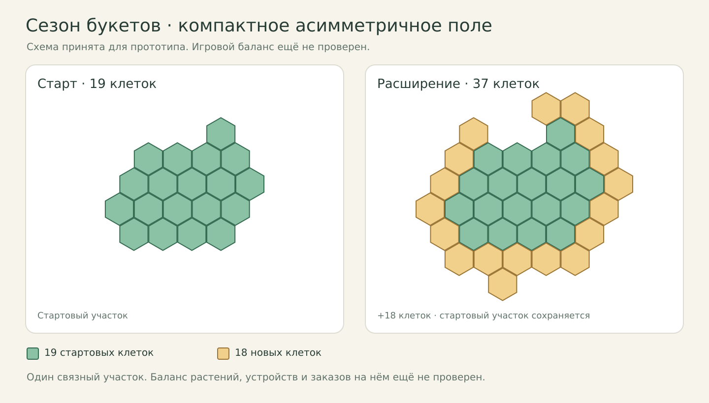

# Сезон букетов — согласованный бриф прототипа

Статус: **бриф целиком утверждён владельцем 2026-10-26, реализация не начата**.
Основа — решения из [GAME-IDEAS.md](GAME-IDEAS.md): пакеты сложности,
выращивания, заказов и постоянной прогрессии №2, все 12 эффектов, сюжет,
районная ярмарка и пять технических правил. **Четыре допущения реализации
в конце раздела 6 также согласованы** как рабочая основа с последующей проверкой.
Баланс, UI и производительность пока не проверены прототипом.
Для новой сессии — [точка продолжения](GAME-IDEAS.md#продолжение-на-другом-устройстве).
После создания worktree документ станет основой `games/bouquet-season/DESIGN.md`,
а его выжимка — первым разделом `NOTES.md` в будущем worktree.

## Согласованная сводка перед worktree — 2026-10-26

Это утверждённый бриф, **не отчёт о готовой игре**.

| Часть | Согласованная основа |
|---|---|
| Игра | «Сезон букетов», Phaser + TypeScript, браузер ПК и телефона, уютный современный город |
| Сезон | До 20 дней по кнопке, пять разных ступеней основных заказов, затем финал |
| Пространство | Фиксированное асимметричное поле, 19 → 37 шестиугольных клеток |
| Выращивание | 6 видов, лампы и поливатели, свет/вода, соседство, повторная срезка, увядание |
| Прогресс сезона | 12 эффектов, выбор улучшений после основных заказов, модули |
| Заказы | Базы 8 → 14 → 20 → 26 → 32; одному подарочному букету +1 |
| Финал | 48 цветов, витрина мастерской или городская выставка на выбор, 96 монет и 96 опыта |
| Дополнительный контент | 3 шаблона срочных просьб, 2 появления за сезон, районная ярмарка, 3 сюжетных квеста |
| Постоянный прогресс | Деньги и опыт, 4 покупаемых вида, расширение поля и доски; покупки между сезонами |
| Проигрыш | Репутация 3/3, штрафы обязательных заказов; потеря 25% дохода с округлением вниз |
| Интерфейс | Подробнее доска и окна, упрощённое поле; пометки риска и подтверждение опасной сдачи |
| Сохранения | После каждого действия, предыдущая корректная копия, восстановление с подтверждением |

Вне скелета — ручное декоративное составление букета, грунт/климат, дневная
энергия, порча склада, случайное поле, другие режимы и эпохи, облачная синхронизация
и ручной перенос сейва. Их выбранные будущие варианты сохранены в GAME-IDEAS.md.

Владелец согласовал **бриф целиком, включая допущения реализации в разделе 6**.
Проверки из раздела 7 планируются после реализации; игра, баланс и удобство
на устройствах пока не проверены. Следующий шаг — worktree с владельцем.
Согласование брифа не является разрешением на Git-операции.

## 1. Бриф — выбранные решения

- `id`: **`bouquet-season`**.
- Рабочее название: **«Сезон букетов»**. Отображаемое имя для публикации выберем позже.
- Концепция: «Оранжерея»; уютная цветочная мастерская в современном городе.
- Жанр: спокойная пространственная стратегия с конечными сезонами, случайными
  заказами, выбором сезонных улучшений и постоянным развитием мастерской.
- Движок: **Phaser + TypeScript**, инструментальная цепочка проекта.
- Первая версия: **браузер на ПК и телефоне**, сначала Game Factory, затем
  подготовка к CrazyGames. Оба положения телефона, одинаковые правила и баланс.
- Версия прототипа: `0.1.0`, по правилам проекта; публичный выпуск — отдельное решение.
- Нет рейтинга сезона и таблицы рекордов. Деньги и опыт служат постоянному развитию.
- Автосохранение после каждого завершённого действия: профиль, текущий сезон,
  предложения заказов и улучшений, настройки и сюжетный прогресс.
- При ошибке обязательной записи **приостанавливаем новые игровые действия**,
  оставляем текущее состояние в памяти и предлагаем повторить сохранение.
  После успешной записи продолжаем с того же состояния, не повторяя награды.
- **Для прототипа выбран текущий автосейв и одна предыдущая корректная копия**
  (вариант 1 вопроса о локальном резервировании). **Восстановление 2 + 3:
  команда в меню и подтверждение игрока**, без автоматического отката.
  Команда остаётся доступной при повреждении основного сейва; исправный резерв
  не перезаписывается повреждённым основным при ротации. Восстановление заменяет
  состояние целиком, не суммирует деньги и награды. Ошибка записи во время игры
  по-прежнему вызывает паузу с повтором текущей записи.
- Принятый технический формат после вопроса владельца о SHA: SHA-256 для целостности
  каждой отдельной записи, версия формата, последовательный номер записи,
  дата для показа игроку и проверка игровых ограничений. Каждая копия сверяется
  со своим сохранённым хешем; разные хеши основной и предыдущей копий ожидаемы.
  Хеш не определяет свежесть, совместимость или честность. Схема ещё не реализована;
  подробности и источники — в разделе сохранений GAME-IDEAS.md.
- **На будущее выбран вариант 4 резервирования: предыдущая копия плюс
  ручной перенос сейва**. В начальный скелет ручной перенос не входит.
  Возможен переносимый текст для копирования/вставки; интерфейс ещё не проверен.
  Прямое скачивание файла из iframe Game Factory сейчас не разрешено песочницей.
  Контрольные точки и история нескольких копий остаются другими предложениями,
  не выбранными автоматически для будущего. Для синхронизации
  **предварительно выбран вариант 5**: автоматически продолжать одну ветку,
  при независимых изменениях сохранить обе версии и предложить выбор.
  **Вопрос оставлен открытым и отложен на будущее по просьбе владельца**;
  перед интеграцией ещё предстоит окончательно выбрать способ и правила.
  Безусловный приоритет локального сейва не утверждён; сам по себе он
  не защищает от подмены. Детали, ограничения SDK и источники —
  [в разделе о синхронизации](GAME-IDEAS.md#синхронизация-и-резервные-копии--обсуждение).
- Предложение для манифеста: `offline: false`; права `saves`, `audio`, `fullscreen`,
  `orientation-lock` для обычного окружения Game Factory. Точный набор сверить
  с фактическими вызовами при реализации. Для CrazyGames учесть требования портала.

## 2. Границы первого рабочего прототипа

### Выбранный объём

| Система | Объём |
|---|---|
| Режим | Один конечный сезон: 5 выполненных основных заказов и финал |
| Поле | Шестиугольное, 19 клеток; одно постоянное расширение до 37 |
| Растения | 6 видов: 2 начальных, 4 приобретаемых по постоянной прогрессии |
| Оборудование | Лампа и поливатель, по одной клетке, базовая зона — 6 соседних клеток |
| Сезонные улучшения | 12 различных эффектов, включая общие эффекты, модули и сюжетные открытия |
| Модули | Один на объект, свободный перенос между совместимыми объектами внутри дня |
| Обычные основные заказы | 8 рецептов; выбор из максимум 3 уникальных выполнимых сохраняемых предложений без ручного обновления; автоматическая замена истёкшего набора |
| Финальный заказ | Одна большая композиция на выбор из максимум 3 уникальных выполнимых сохраняемых предложений без ручного обновления; витрина мастерской или городская выставка, 48 цветов из 2–4 видов |
| Срочные просьбы | 3 варианта, добровольные, на событийных местах доски |
| Городское мероприятие | 1 сценарий: обязательный минимум и дополнительные цели |
| Сюжет | Одна цепочка из 3 квестов об открытии мастерской |
| Доска | Изначально 1 основной и 1 событийный заказ; расширяется по прогрессии |
| Звук | Звуки действий и интерфейса |
| Настройки | Громкость, сокращённые переходы, отключение обучающих подсказок, восстановление сохранения с подтверждением |

Число сценариев событий не определяет частоту появления. Доска расширяется
до двух основных и двух событийных мест; цены и пороги указаны в разделе 6.

### Последующее развитие

Список выбранных владельцем будущих альтернатив сохраняется в GAME-IDEAS.md.
В текущий объём не входят песочница, выживание, блиц, другие эпохи и типы хозяйств,
грунт и климат, дневная энергия, случайная геометрия, порча и ограничения запасов,
выведение растений, ягоды и фрукты, ручная декоративная сборка букета, сложные сети
оборудования, два слота модулей, музыкальное оформление, рейтинги и дополнительные
форматы запуска. Эти идеи не требуется реализовывать или заранее строить для них системы.

## 3. Игровой цикл и постоянная прогрессия

1. Вход в мастерскую показывает уровень, сюжетную цель, начало или продолжение сезона.
2. Новый сезон получает открытое поле и каталог, пустую расстановку, без прошлых
   сезонных эффектов. Стартовое оснащение уточняется в таблицах контента.
3. Игрок принимает основной заказ из максимум трёх предложений, размещает растения и устройства.
4. Внутри дня спокойно перестраивает хозяйство. День продвигается только явной кнопкой
   и при наличии активного основного заказа; растения обновляются одновременно.
5. Собирает готовые цветы по одному или кнопкой «Собрать всё», сдаёт точный состав.
6. После каждого выполненного основного заказа выбирает одно улучшение из трёх:
   для растения, для оборудования, любой категории. Эффекты относятся к открытому контенту.
7. Срочные просьбы и календарное мероприятие дают дополнительные цели и заранее
   указанные награды; отмеченные цели могут давать сезонное улучшение.
8. После пятого основного и завершения выбора его улучшения открываются предложения
   финальной композиции. Сдача выбранного финала — немедленная победа.
9. Нулевая репутация или незавершённый финал к концу последнего дня — поражение.
10. Итоги показывают результат, заработок, опыт и постоянные открытия. Затем доступны
    постоянные покупки и следующий сезон.

Ориентир длительности — **15–20 минут активной игры**, проверяется на игроках;
игровые дни не привязаны к минутам реального времени.

### Деньги и поражение — выбрано

- Доход сезона учитывается и сохраняется отдельно от накоплений прошлых сезонов.
- Постоянные покупки доступны **только между сезонами**, после расчёта результата.
- Победа переводит весь заработок в постоянный кошелёк. Поражение теряет долю
  заработка текущего сезона, остальное зачисляется. Выбрана потеря **25%**;
  потеря округляется вниз до целой монеты: floor(доход / 4).
- Старые накопления, опыт, покупки и весь сюжетный прогресс сохраняются при поражении.
- Опыт открывает доступ к покупке; растения, оборудование и расширения приобретаются
  за постоянные деньги между сезонами. Размещение открытого каталога внутри сезона свободное.
- Итоги рассчитываются один раз и сохраняются до рекламного перехода. Перезагрузка
  и повторное открытие итогов не выдают награды снова.

### Выращивание — выбрано

- Начальные цветы: гвоздика и хризантема. Открываемые: роза, тюльпан, гербера, лилия.
- Гвоздике нужен полив, свет ускоряет рост; хризантеме нужен свет, полив ускоряет рост.
  Это игровые роли, а не ботанические утверждения.
- Для всех шести видов выбраны два существующих профиля ухода:

  | Вид | Обязательное условие | Дополнительное условие: +50% к скорости |
  |---|---|---|
  | Гвоздика | Полив | Свет |
  | Хризантема | Свет | Полив |
  | Роза | Полив | Свет |
  | Тюльпан | Свет | Полив |
  | Гербера | Свет | Полив |
  | Лилия | Полив | Свет |

  Различия новых видов в скелете дают рецепты и открытие по прогрессу.
  Для развития выбраны особое соседство, бонусы за свободное пространство
  или плотную посадку и предпочтения света/полива, меняющиеся между сезонами,
  но стабильные внутри сезона. Два обязательных условия из варианта 2
  последнего вопроса в этот план не включены: владелец уточнил «потом 3–5».
  Сочетание будущих механик и этапы добавления пока не выбраны.
- Сосед своего вида ускоряет рост; сосед другого вида увеличивает урожай.
  Каждый бонус действует один раз независимо от числа соседей.
- Бонусный урожай требует подходящих условий **все дни цикла**. При созревании
  урожай фиксируется; перестановка перед срезкой не увеличивает его.
- При плохих условиях цветок постепенно увядает и может погибнуть; после исправления
  восстанавливается с паузой роста. Замена теряет весь старый прогресс.
- Пересадка сохраняет прогресс и пропускает один день роста. Перенос модуля — отдельное действие.
- После срезки растение остаётся и начинает новый цикл. Ускорения ограничены
  минимальной длительностью **2 дня роста**. Базовый срок — **4 дня**, урожай —
  **2 цветка**, при бонусном соседстве весь цикл — **3**.
- Зоны одинаковых устройств не усиливают свет или полив. Оборудование переставляется
  мгновенно. Запас срезанных цветов не ограничен и не портится в пределах сезона.

## 4. Управление и интерфейс

| Действие | ПК | Телефон |
|---|---|---|
| Выбор и размещение | Выбор объекта, нажатие на клетку или перетаскивание | Выбор и касание клетки либо перетаскивание одним пальцем |
| Камера | Колесо — масштаб; средняя кнопка с перетаскиванием и WASD/стрелки — перемещение | Масштаб и перемещение двумя пальцами |
| Общий обзор | Кнопка возврата ко всему полю | Та же кнопка |
| Доска, каталог, магазин | Кнопки и объекты сцены | Нижняя панель и объекты сцены |
| Следующий день, сбор, сдача | Явные кнопки | Те же действия, цели касания не меньше 48 px |
| Условия | Контекстная подсветка и слои света, полива, соседства | Те же подсветки и слои |

Основной экран — оранжерея; доска, каталог и магазин открываются поверх поля.
На ПК выбраны оба способа перемещения камеры (варианты 1 + 4).
Размещение и перетаскивание объектов левой кнопкой не перемещают камеру.
Внутри сезона магазин может показывать будущие покупки, но приобретение доступно
между сезонами; точное представление — предложение для макета.

Отмена возвращает последнее изменение расстановки до следующего завершённого
действия, меняющего состояние; сбор, сдача, награда и день закрывают отмену.
Удаление растения требует подтверждения. Отмена сохраняется.

Первое обучение — подсказки внутри первого настоящего заказа. Можно пропустить
в любой момент или отключить в настройках; порядок не отменяется, действия сохраняются.
Переход от входа к оранжерее — плавный и умеренный по длительности, сокращается настройкой.

Для концепта выбрано чистое мультяшное 2D с наклонённым видом сверху и вертикальными
силуэтами. **Для игрового прототипа выбран вариант 4 проработки графики**:
подробнее оформляем доску заказов и интерфейс, растения и поле оставляем упрощёнными.
Виды растений, состояния роста и условия ухода должны оставаться различимыми.
Оформление для публикации ещё не выбрано. Графика своя, концепты после создания
worktree хранятся в `games/bouquet-season/concepts/` по правилам проекта.

## 5. Стартовый баланс

Владелец выбрал **пакет 2**: **20 дней сезона, обычный заказ — 5 дней, финал — 7,
репутация 3 / 3, потеря дохода при поражении — 25%**. Это стартовые параметры для
проверки, а не результаты расчёта сложности. Восстановление репутации не превышает её максимума.
Провал основного заказа или обязательного минимума мероприятия теряет 1 репутацию;
срочная просьба не штрафует и в этих пакетах не восстанавливает репутацию.

| № | Направление | Дней сезона | Срок обычного заказа | Срок финала | Репутация: старт / максимум | Восстановление за основной заказ | Потеря дохода при поражении |
|---|---|---|---|---|---|---|---|
| 1 | Мягкое знакомство | 24 | 6 | 8 | 5 / 5 | 1 | 10% |
| 2 | Умеренное напряжение | 20 | 5 | 7 | 3 / 3 | 1 | 25% |
| 3 | Плотный календарь | 16 | 4 | 6 | 3 / 3 | 1 | 25% |
| 4 | Больше времени, ощутимый риск | 30 | 7 | 10 | 3 / 3 | 1 | 35% |
| 5 | Высокая ставка | 20 | 5 | 7 | 2 / 2 | 1 | 40% |

Остальные пакеты выше — невыбранные предложения, а не планы реализации.
Сроки выбранного пакета ещё нужно согласовать с таблицами роста,
урожая и количества цветов. Поздние предложения фильтруются по оставшемуся времени;
финальный срок ограничен общим последним днём. Фильтр не должен выдавать непроходимый
заказ только потому, что его вид растения уже открыт.

Принятые границы дня: рост происходит при входе в день, сдача разрешена весь
день дедлайна, в том числе после его роста и срезки. Просрочка фиксируется при
завершении этого дня, до роста следующего. День 20 также оставляет время на
срезку и сдачу; его завершение подводит итоги без роста дня 21.
Принят отсчёт **с появления предложения, не с принятия**. Если обычный заказ
появился в день d, дедлайн — min(d + 5, 20), для финального — min(d + 7, 20).
Например, обычное предложение дня 3, принятое в день 5, остаётся доступным
для сдачи до конца дня 8. День появления и дедлайн сохраняются; ожидание,
принятие и перезагрузка их не меняют. Истёкшая непринятая тройка автоматически
заменяется новой **без штрафа**, новая сохраняется. Принятые заказы этим
не заменяются и не продлеваются. Обновление не продвигает день и не даёт роста;
переход дня по-прежнему требует активного основного заказа. До истечения
ручного обновления в скелете нет. При позднем принятии проверять оставшуюся
выполнимость; способ проверки уточнить в генераторе.
Для развития выбрано ручное обновление: донат или открытие через прогресс
пока рассматриваются без выбора способа, цены и лимитов. Ранее сохранённое
одно бесплатное обновление за сезон остаётся альтернативой. Платежи в скелет
не входят; будущие варианты подробно сохранены в GAME-IDEAS.md.
Порядок просрочек, итогов и роста и смена уже показанной непринятой тройки
при возвращении ранней ступени подтверждены ниже.

**Старт сезона — подтверждён владельцем:** день 1 начинается
без предварительного роста; при уже записанной пустой расстановке запас срезанных
цветов равен нулю. Постоянные открытия и накопления сохраняются по выбранным правилам.
В день 1 появляются до трёх выполнимых предложений первой ступени с базой 8 цветов
(9 для одного подарочного букета по уточнению чётности),
со сроком до конца дня 6. Игрок выбирает заказ и размещает растения и оборудование;
первый рост — при явном переходе ко дню 2, только с активным основным заказом.
Внутри дня автоматического роста нет; бесплатный подготовительный день
и готовый урожай не добавлены.

**Порядок перехода дня — подтверждён владельцем:**

1. Проверить наличие активного основного заказа при нажатии кнопки.
2. Закрыть истёкшие в текущий день принятые основные и ярмарку со штрафами,
   срочные просьбы и непринятые предложения без штрафов. Все штрафы этого
   перехода применяются вместе, до роста следующего дня.
3. При нулевой репутации или завершении дня 20 рассчитать итоги без нового роста.
   Победа по сдаче финала уже немедленная и нового нажатия не требует.
4. Иначе перейти к следующему дню и один раз одновременно обновить растения.
5. После обновления показать положенные события и новые предложения,
   проверенные по состоянию нового дня. Их сроки начинаются с этого появления.
6. Сохранить завершённое действие; до успешной записи не возобновлять ввод.
   При ошибке сохраняется принятая пауза с повтором записи без повторного роста.

Активный основной проверяется при нажатии: если он просрочился
в пункте 2, уже разрешённый переход завершается один раз; для следующего
понадобится новый активный основной.
Не создавать временную тройку перед ростом с повторным запуском сроков.
Если после просрочки ближайшей свободной стала более ранняя ступень,
непринятые предложения поздней заменяются по подтверждённому правилу ниже.

### Чётность по назначению заказа — уточнение от 2026-10-26

**Владелец отозвал нечётность каждого вида: правило зависит от назначения заказа.**
По его просьбе проверена российская традиция: подарочные букеты обычно нечётные,
траурные — чётные; считать следует сумму цветочных стеблей отдельного букета.
Например, 3 розы + 4 тюльпана дают 7; нечётность каждого ингредиента не требуется.
Практика для крупных и смешанных композиций мягче, единого числового порога нет.
Это местная культурная традиция, не общемировое правило. Источники и оговорки —
в разделе «Чётность и назначение заказа» GAME-IDEAS.md.

**Подтверждено владельцем:** различать один подарочный букет,
траурный букет и поставку/оформление. Для подарочного букета добавлять 1 к базовому
чётному объёму: 9 → 15 → 21 → 27 → 33, финал-подарок — 49. Для поставок,
оформления и траурного букета по этому обычаю сохранять прежние чётные объёмы.
Для партии подарков проверять каждый букет отдельно: два по 7 дают 14.
Пропорции ингредиентов сохраняют выбранный характер с целым остатком;
лентами и декором чётность цветов не менять. Награды считать по фактическому объёму.
U1/U2 — подарки по 9 цветов, U3 — свадебный букет на 13, награды пересчитаны
в таблице событий. Финал скелета — оформление витрины или работа для выставки,
обе темы по 48 цветов; 49 — лишь следствие общего правила для подарочного типа,
который для финала скелета не выбран. Типы обычных карточек ещё указать;
похоронные события автоматически в первый сезон не добавлены.
Базовые объёмы ниже — для поставок и оформления; для одного подарочного букета
применяется явная поправка +1. Формат и фактический состав показываются в предложении
и фиксируются при его создании. Число предложений на выбор этим уточнением не меняется.

### Выращивание — выбран пакет 2

Для скелета выбран один базовый набор чисел для всех видов; обязательные
условия и цель заказа различают растения. Разные темпы и урожайность по видам
сохранены как дальнейшее развитие в GAME-IDEAS.md.

| № | Направление | Рост без ускорений | Базовый урожай за срезку | Дополнительный урожай за соседа другого вида весь цикл |
|---|---|---|---|---|
| 1 | Быстрый малый урожай | 3 дня | 1 цветок | +1 цветок |
| 2 | Умеренный темп | 4 дня | 2 цветка | +1 цветок |
| 3 | Долгое ожидание, большой урожай | 5 дней | 3 цветка | +1 цветок |
| 4 | Сильная роль соседства | 4 дня | 1 цветок | +2 цветка |
| 5 | Ограниченное производство | 5 дней | 2 цветка | +1 цветок |

Вместе с пакетом 2 приняты общие правила:

- Скорость без бонусов — 1 единица роста в день. Дополнительное полезное условие
  даёт +0,5 единицы, сосед того же вида — ещё +0,5. Это два независимых бонуса.
- Число единиц до готовности равно базовому сроку. Минимум — **2 дня роста** за цикл,
  даже если будущий эффект ускорит заполнение шкалы. Например, в пакете 2 полный
  набор условий сокращает рост с 4 до 2 дней. Повторное цветение использует тот же цикл.
- При отсутствии обязательного условия нет роста и накапливается увядание:
  после первого плохого дня предупреждение, второго — опасное состояние,
  третьего подряд — гибель. Число дней видимо в карточке.
- Это правило действует и на готовые, но ещё не срезанные цветы.
  Пока растение живо, готовый урожай можно срезать; при гибели несрезанный
  урожай пропадает. Срезанный запас по-прежнему не портится.
- Исправление условий до гибели требует **1 дня восстановления** без роста,
  затем продолжается сохранённый цикл. Пересадка уже выбрана как 1 день адаптации.

Выбран **пакет 2** и перечисленные общие правила. Остальные строки — невыбранные
предложения. Составы и количества заказов выбраны в таблицах ниже;
их соответствие производительности ещё не проверено игрой.

## 6. Контент и оставшиеся уточнения

### Распределение 12 эффектов — выбран вариант 1

Общий эффект действует на все объекты выбранного вида растения или типа устройства;
модуль — на один совместимый объект и может переноситься. Оба способа уже выбраны,
владелец выбрал их соотношение и равный акцент на растениях и оборудовании.
Все строки содержат 12 эффектов; выбран вариант 1, остальные — невыбранные предложения.

| № | Акцент | Для растений | Для оборудования | Общие эффекты | Модули |
|---|---|---|---|---|---|
| 1 | Равновесие | 6 | 6 | 6 | 6 |
| 2 | Растения и соседство | 8 | 4 | 6 | 6 |
| 3 | Зоны и взаимодействия оборудования | 4 | 8 | 6 | 6 |
| 4 | Перестановка модулей | 6 | 6 | 4 | 8 |
| 5 | Развитие всего хозяйства | 6 | 6 | 8 | 4 |

Это два способа подсчёта одного набора: целевые объекты и форма применения.
Выбран вариант 1. В каждой категории приняты 3 общих эффекта и 3 модуля,
конкретные свойства и правила сочетания также приняты ниже.

### Конкретные 12 эффектов — приняты

Статус этого набора: **владелец принял все 12 эффектов и предложенные правила сочетания**.
Названия рабочие. Простые прибавки к числам, расходуемые инструменты и эффекты
с отрицательными сторонами остаются последующим развитием, как выбрано ранее.

#### Растения: 3 общих эффекта и 3 модуля

| id | Название | Форма | Свойство | Решение для игрока |
|---|---|---|---|---|
| P1 | Смена предпочтений | Общий, выбранный вид | Обязательное и дополнительное условия света и полива меняются местами | Приспособить вид к доступным зонам и изменить соседство |
| P2 | Свет от соседей | Общий, выбранный вид | Свет есть, если рядом живой цветок того же вида, напрямую освещённый устройством или минилампой | Собрать группу, часть которой может обходиться без прямой зоны лампы |
| P3 | Вода от соседей | Общий, выбранный вид | Полив есть, если рядом живой цветок того же вида в прямой зоне поливателя | Выстроить группу вокруг поливаемых растений и освободить место устройств |
| P4 | Смешанная клумба | Модуль на растение | Условием бонуса скорости от соседства становится сосед другого вида; величина остаётся +50% | Ускорять смешанную посадку, одновременно сохраняя урожайное соседство |
| P5 | Подпорка у устройства | Модуль на растение | Соседнее устройство может выполнять условие бонусного урожая вместо цветка другого вида | Получить обычный бонус +1 в группе одного вида или у отдельно стоящего цветка |
| P6 | Минилампа | Модуль на растение | Само растение напрямую получает свет | Обеспечить условие одному цветку; сочетать со «Светом от соседей» |

Свет и полив от соседей переносятся **на один шаг от прямого источника**:
растение, получившее условие только через соседа, не становится новым источником
для следующего. Это не требует затрат воды или энергии в выбранном скелете.
Минилампа освещает только свой объект; её распространение на соседей требует P2.
Базовая скорость от дополнительного условия и от соседства остаётся двумя
независимыми бонусами по +50%, минимум 2 дня роста сохраняется.

P5 даёт уже существующий бонус урожая +1: если есть и другой вид, и устройство,
бонус учитывается один раз. Альтернативное условие через устройство и присутствие
модуля должны выполняться весь цикл; подключение модуля перед срезкой не меняет
урожай. Для реализации отдельно хранить историю каждого допустимого
источника урожайного бонуса; базовое соседство весь цикл остаётся самостоятельным
способом получения +1. Объединение разных источников по частям цикла не даёт бонуса.

#### Оборудование: 3 общих эффекта и 3 модуля

| id | Название | Форма | Свойство | Решение для игрока |
|---|---|---|---|---|
| E1 | Дальний свет | Общий для ламп | К базовым 6 соседям добавляются 2 клетки второго кольца по фиксированной оси поля | Обслужить растения дальше от лампы, выбирая её позицию |
| E2 | Дальний полив | Общий для поливателей | К базовым 6 соседям добавляются 2 клетки второго кольца по другой фиксированной оси | Согласовать отличающиеся зоны света и воды |
| E3 | Парная установка | Общий, выбранный тип устройства | Устройство рядом с устройством другого типа распространяет своё условие также на его собственную зону | Собрать пару с общим участком обслуживания или разнести устройства |
| E4 | Двойной уход | Модуль на лампу или поливатель | Устройство даёт и свет, и полив в своей зоне | Обеспечить оба условия одним устройством и освободить клетку |
| E5 | Кольцевая насадка | Модуль на устройство | Базовая зона заменяется 12 клетками второго кольца, ближайшие 6 не входят | Разместить обслуживаемые растения дальше, использовать внутренние клетки иначе |
| E6 | Лепестковая насадка | Модуль на устройство | Базовая зона заменяется ближайшими 6 клетками и 6 угловыми клетками второго кольца | Обслуживать близкие и отдельные дальние группы |

Фиксированные оси E1 и E2 — две разные оси шестиугольной сетки;
вращение устройств и выбор направлений оставлены на будущее. Все зоны показываются
до размещения, обрезаются по доступному полю и не складывают интенсивность.

Порядок сочетания: сначала модуль определяет собственную зону, затем общий эффект
E1 или E2 добавляет дальние клетки. Повторяющиеся клетки учитываются один раз.
E3 использует собственные зоны соседних устройств **до применения E3**, поэтому
не создаёт рекурсивную сеть. E4 добавляет второе условие в собственной зоне;
заимствованная через E3 зона получает условие исходного типа устройства.

Пример синергии: P6 освещает одно растение, P2 обеспечивает светом
соседние растения того же вида. Это может освободить место лампы, но занимает
модульный слот и требует подходящего размещения группы.
E3 поддерживает парную установку, а E4 даёт возможность освободить место второго
устройства; на прототипе проверить, нужны ли игроку оба подхода.

Для проверки урожайных условий учитывать все переходы дня от посадки
или последней срезки до созревания, включая адаптацию и восстановление. Историю
фиксировать до одновременного обновления растений; при созревании сохранять итог
до срезки. Это уточнение принято вместе с набором.
Разделение на начальные и сюжетные эффекты принято в таблице 3 квестов ниже;
сюжетные эффекты входят в эти 12, а не увеличивают их число.

### Рецепты, объём и награды заказов — выбран пакет 2

Статус: **владелец выбрал пакет 2, 8 рецептов и общие правила наград**.
Чётность по назначению согласована: базовые объёмы для поставок и оформления,
для одного подарочного букета +1 к базе. Финал — витрина или выставка на 48 цветов.
Остальные пакеты — невыбранные предложения. Все пять пакетов ниже используют
одни и те же 8 рецептов. При создании предложения проверяется доступность всех
ингредиентов; с самого начала доступны R1–R3. В карточке всегда указан точный состав.

| id | Рецепт | Пропорции |
|---|---|---|
| R1 | Гвоздики | Один вид |
| R2 | Хризантемы | Один вид |
| R3 | Гвоздики и хризантемы | 1:1 |
| R4 | Розы и гвоздики | 1:1 |
| R5 | Тюльпаны и хризантемы | 1:1 |
| R6 | Герберы и розы | 1:1 |
| R7 | Лилии и тюльпаны | 1:1 |
| R8 | Розы, герберы и лилии | 1:1:1 |

Объём — суммарное число цветов, распределённое по пропорциям рецепта. Остаток
при делении распределяется по порядку ингредиентов таблицы. Например, R3 объёмом
14 — 7 гвоздик и 7 хризантем; R8 объёмом 20 — 7 роз, 7 гербер и 6 лилий.
Это 8 шаблонов, а не увеличение согласованного количества рецептов.
Для подарка те же примеры дают 15 цветов R3 — 8 гвоздик + 7 хризантем,
21 цветок R8 — по 7 каждого вида. Чётность проверяется для суммы букета.

| № | Пакет | Базовые объёмы обычных заказов на ступенях 1 → 5 | База финала |
|---|---|---|---|
| 1 | Мягкий рост | 6 → 10 → 14 → 18 → 22 | 36 |
| 2 | Постепенное развитие | 8 → 14 → 20 → 26 → 32 | 48 |
| 3 | Большие партии | 10 → 18 → 26 → 34 → 42 | 60 |
| 4 | Равномерное производство | 20 → 20 → 20 → 20 → 20 | 48 |
| 5 | Чередование нагрузки | 8 → 20 → 14 → 32 → 26 | 48 |

Принятые общие правила:

- Обычная награда — **2 монеты и 1 опыт за каждый требуемый цветок**.
  Финал — **2 монеты и 2 опыта за цветок**. Заказ оплачивается целиком при сдаче;
  лишние цветы остаются в запасе, дополнительно оплачиваемой сдачи нет.
- Финал требует **48 цветов из 2–4 доступных видов**. Владелец выбрал
  **варианты назначения 1 и 4 на выбор игрока**: композиция для витрины мастерской
  либо работа для городской цветочной выставки. Это две темы одного финального
  заказа, не два обязательства и не дополнительные самостоятельные события.
  Владелец разрешил
  **разные пропорции**, заменив прежнее требование равных долей финала.
  Принят **выбор одного финала из максимум трёх предложений без ручного обновления**.
  Составы фиксируются при открытии финала, фильтруются по выполнимости
  и сохраняются; перезагрузка не меняет набор. Выполняется одна выбранная
  композиция, не все три. Даже при двух стартовых видах предложения могут
  различаться долями гвоздик и хризантем. Приняты **умеренные шаблоны**:
  равные доли либо один ведущий вид с весом 2, остальные с весом 1.
  Для объёма 48 и двух видов это 24 + 24, 32 + 16 и 16 + 32; для трёх — равные
  16 + 16 + 16 либо 24 + 12 + 12 с разным ведущим видом.
  Для четырёх равный состав — по 12, ведущий — веса 2:1:1:1;
  остаток распределяется по наибольшим дробным частям, при равенстве —
  по порядку ингредиентов. Например, 48 при 2:1:1:1 — 19 + 10 + 10 + 9.
  Обе темы требуют 48 цветов и дают 96 монет и 96 опыта.
  При двух и более уникальных выполнимых составах представлены обе темы.
  Смена названия без изменения состава не считается уникальным предложением;
  если выполнимый состав один, показываем его по правилу нехватки вариантов.
  Отдельной нечётности каждого вида нет. Ставки награды за цветок и сроки
  не меняются. Это не меняет равные веса обычных
  рецептов R1–R8. При нехватке трёх показываем только найденные 1–2
  уникальных выполнимых предложения, без дубликатов и корректировки баланса
  ради числа карточек. При нуле действует общее правило пустой доски ниже.
- Для дальнейшего рассмотрения сохранены приоритет недавно открытых видов
  в финале и заранее заданные тематические рецепты. Их сочетание с выбором
  из трёх предложений и включение в игру пока не выбраны.
- Сроки уже выбраны: **5 дней обычному заказу, 7 финальному с появления
  предложения**, в пределах календаря дня 20. Принятие не перезапускает срок.
  Количества не растут после принятия заказа и не меняются при перезагрузке.
- После покупки второго основного места два заказа можно выполнять параллельно.
  Оба идут в общий счётчик **5 выполненных основных перед финалом**;
  покупка не добавляет шестого обязательного заказа.
- Приняты **пять отдельных ступеней с базами 8, 14, 20, 26 и 32 цветка**;
  для одного подарочного букета фактические объёмы — 9, 15, 21, 27 и 33.
  Принятый заказ резервирует ближайшую незавершённую свободную ступень;
  второй может занять следующую. Параллельные заказы занимают разные ступени,
  сдавать можно в любом порядке. Каждую нужно завершить один раз; проваленная
  остаётся незавершённой и требует повторного заказа. Её нельзя заменить
  дополнительным выполнением более лёгкой ступени.
- Для ближайшей свободной незавершённой ступени показывается **одна общая
  тройка предложений**. После принятия заказа следующая тройка появляется
  сразу, если осталось свободное основное место. Когда оба места заняты,
  будущие предложения не создаются и их сроки ещё не идут. Одновременные
  события доски обрабатываются по подтверждённому порядку дня и правилу
  замены ниже. После пятого основного сначала завершается выбор улучшения,
  затем создаются предложения финала; ожидающий выбор сохраняется.
- При просрочке принятого обычного основного заказа старый закрывается,
  теряется 1 репутация, ступень остаётся незавершённой. Если есть репутация
  и выполнимое продолжение в календаре, выдаётся **новая сохраняемая тройка
  той же ступени**. База объёма прежняя, фактический объём определяется форматом
  нового предложения (+1 для одного подарочного букета). Составы подбираются заново без гарантии
  сохранения старого рецепта. Новая попытка получает срок 5 дней с появления
  предложений в пределах дня 20. Другие активные заказы сохраняют свои сроки;
  это новый заказ, а не продление просроченной карточки.
  При переходе дня новые предложения появляются после роста, если сезон
  продолжается; сроки считаются от дня этого появления, до приёма игроком.
  Смена уже показанной непринятой тройки при возвращении более ранней ступени
  подтверждена ниже.

  **Замена неистёкшей тройки — подтверждена владельцем:** если после провала
  ближайшей свободной снова стала более ранняя ступень, убрать непринятые предложения
  поздней и после роста показать новые для ранней, с пояснением причины.
  Их сроки начинаются с нового появления; уже принятые заказы и их сроки сохраняются.
  Снятие непринятых карточек дополнительного штрафа не даёт. При нескольких
  провалах сначала показывается ближайшая ступень; при завершении сезона — ни одной.
  Если ступень не изменилась, само изменение выполнимости не разрешает обновлять
  неистёкшие предложения.
- Выполнимость проверять по количествам и времени выращивания, доступному полю,
  оборудованию и остальным обязательствам. Открытого вида недостаточно для гарантии.
  Если для обычного основного или финального заказа подходят только 1–2
  уникальных варианта, показываем их. Дубликаты и скрытые изменения объёмов,
  наград или сроков для заполнения трёх карточек не используются.
  Отказ эвристики сам по себе не доказывает невозможность продолжения сезона.
  В совместном плане один и тот же срезанный цветок нельзя учитывать
  для двух сдач; требуется учитывать будущие урожаи и дедлайны. Автоматическое
  резервирование склада этим не вводится.
  **Выбрана политика 2:** если срочная просьба выполнима отдельно, но конкурирует
  с обязательными заказами за ресурсы, показываем предупреждение до принятия
  и разрешаем добровольно принять. За провал теряется только возможная награда,
  без штрафа репутации. Сам риск не блокирует принятие и не откладывает карточку.
  **Выбран вариант интерфейса 3:** пометка на карточке плюс подтверждение
  при сдаче, если расход сделает другой уже готовый обязательный заказ неготовым.
  При принятии дополнительного диалога нет. Перед списанием сравнивать текущий
  запас с результатом сдачи; сообщение указывает затронутый заказ и нехватку.
  Предупреждение не резервирует цветы и позволяет подтвердить расход.
  При сдаче финала не предупреждать об угрозе будущему минимуму ярмарки,
  если он закрывается без штрафа из-за немедленной победы.
  Оценку риска нельзя выдавать за доказательство неизбежной просрочки.
  Общая проверка не должна забывать принятую досрочную победу:
  будущий минимум ярмарки не всегда нужно выполнить до финала.
- Если новых выполнимых предложений нет, при наличии активных основных
  продолжаем их. При их отсутствии доступны срезка и перестановки с повторной
  проверкой предложений; показывается причина пустой доски и возможность
  **добровольно закончить сезон поражением** по обычным правилам.
  Бесплатного роста без активного основного нет, автоматического поражения
  из-за нулевого результата поиска тоже нет. Обязательные объёмы и календарный
  предел скрыто не меняются.
  На будущее сохранены спасательный облегчённый заказ с меньшим объёмом
  и наградой и индивидуальный состав под склад при достаточном общем запасе
  с сохранением объёма ступени. Участие в прогрессе, числа и выдача пока
  не выбраны; в скелет эти варианты не входят.

Выбран **пакет 2 с базами 8 → 14 → 20 → 26 → 32, финал 48**;
для одного подарочного букета +1. Это стартовый баланс прототипа;
производительность размещений и длительность сезона ещё не проверены.
Пять успешно выполненных основных требуют суммарно 100 + m цветов,
где m — число подарочных среди них (0–5), независимо от числа основных мест.
Финал — ещё 48, события считаются отдельно.

### Постоянные открытия и их темп — выбран пакет 2

Статус: **владелец выбрал умеренный темп, каталог покупок и цены**.
Опыт накопительный, не расходуется на покупки и сохраняется при поражении.
Порог уровня открывает доступ к покупке; деньги оплачивают само открытие между сезонами.
Все пять вариантов темпа ниже используют один перечень покупок и цен.

| Уровень доступа | Открытие | Цена |
|---|---|---|
| 1 | Гвоздика, хризантема, лампа, поливатель; поле 19; доска 1 основной + 1 событийный | Начальный каталог |
| 2 | Роза | 60 монет |
| 3 | Тюльпан | 80 монет |
| 3 | Второе основное место доски | 120 монет |
| 4 | Гербера | 100 монет |
| 4 | Расширение поля 19 → 37 | 200 монет |
| 4 | Второе событийное место доски | 100 монет |
| 5 | Лилия | 120 монет |

Выбранный предел доски — **2 основных и 2 событийных места**. Покупки независимы:
достижение уровня не требует купить весь предыдущий каталог. Генератор использует
фактически открытые виды, а не только уровень доступа. После открытия размещение
растений и устройств остаётся свободным по принятым правилам.
Второе основное место позволяет параллельно выполнять два заказа с общим
счётчиком до пяти перед финалом; число обязательных выполнений не увеличивается.

Старт нового профиля: 0 монет и 0 опыта, растения и устройства занимают по 1 клетке.
Выбрана **фиксированная асимметричная площадка на шестиугольной сетке**:
19 клеток, единственное расширение до 37. Выбран характер асимметрии —
**компактная основа с выступами и углублениями**; контур одинаков между сезонами.
Конкретная схема и координаты ниже **приняты владельцем для прототипа**.
Это не означает, что игровой баланс на ней уже проверен.
Ранее предложенный полный симметричный шестиугольник не выбран.
Для будущего рассмотрения сохранены выраженные карманы или подкова;
выбор между ними или сочетание пока не сделаны.
Для дальнейшего рассмотрения сохранены соединённые секции или случайная
связная форма между сезонами. Выбор между ними и включение в игру пока
не определены; в скелете поле остаётся фиксированным.
Лампа и поливатель доступны с первого сезона, чтобы выращивать оба начальных вида.

| № | Темп | Опыт для уровня 2 | Для уровня 3 | Для уровня 4 | Для уровня 5 |
|---|---|---|---|---|---|
| 1 | Быстрые открытия | 40 | 100 | 220 | 360 |
| 2 | Умеренный | 60 | 180 | 360 | 600 |
| 3 | Долгое развитие | 100 | 300 | 600 | 1000 |
| 4 | Быстрое начало, дальняя цель | 40 | 100 | 360 | 800 |
| 5 | Ровные ступени | 150 | 300 | 450 | 600 |

Выбран **пакет 2: 60 → 180 → 360 → 600 опыта для уровней 2–5**.
Остальные строки — невыбранные предложения. Успешный сезон без просрочек и событий
даёт **296 + 2m монет и 196 + m опыта**, где m — число подарочных
среди пяти основных заказов (0–5); финал скелета всегда на 48 цветов.
Это **296–306 монет и 196–201 опыта**. Поэтому первая победа
открывает доступ к розе, тюльпану и второму основному месту; купить весь набор стоит
260 монет. Следующие покупки заставляют выбирать между каталогом, местом и доской.
Это расчёт по таблице наград, а не измерение темпа на игроках. События, поражения,
параллельные заказы и реальные размещения могут изменить скорость постоянного развития.

### Точный контур — принят для прототипа

**Статус: владелец принял показанную схему для прототипа.** Зелёные клетки —
начальные 19, жёлтые — 18 добавляемых. Конкретный контур и координаты ниже
используются как стартовый вариант для проверки баланса.
Это схема геометрии, не стиль игры.

В таблице осевые координаты `(q, r)`, соседство по шести направлениям:
`(1, 0)`, `(1, -1)`, `(0, -1)`, `(-1, 0)`, `(-1, 1)`, `(0, 1)`.
Диапазоны включают обе границы; «—» означает отсутствие клеток в строке.

| r | q начального поля | q после расширения |
|---|---|---|
| -3 | — | 2, 3 |
| -2 | 2 | -1, 2, 3 |
| -1 | -1…2 | -2…3 |
| 0 | -2…2 | -3…3 |
| 1 | -3…1 | -4…2 |
| 2 | -3…0 | -4…1 |
| 3 | — | -4…0 |
| 4 | — | -3 |

Проверено вычислением по этим координатам: 19 и 37 клеток; начальное поле
полностью входит в расширенное, разница — 18 клеток. Оба поля связны;
нет одиночной клетки, удаление которой разрывает поле. Число клеток с полным
окружением из шести соседей — 6 и 15 соответственно. Это допускает размещение
устройств с полной базовой зоной, но не доказывает достаточный урожай,
разнообразие решений или баланс срока сезона. Эти свойства требуют прототипа.

### Сюжет и события — принят пакет с районной ярмаркой

Статус: **владелец выбрал районную ярмарку и общий пакет сюжета и событий**.
Общая история остаётся открытием цветочной мастерской. Доступны 9 эффектов
в начальном сезонном наборе, 3 сюжетных открытия входят в согласованные 12.

| id | Квест | Цель | Постоянное открытие |
|---|---|---|---|
| Q1 | Первый клиент | Выполнить 1 основной заказ | P5, «Подпорка у устройства» |
| Q2 | Благодарные соседи | Всего выполнить 3 основных заказа и 1 срочную просьбу | E3, «Парная установка» |
| Q3 | Первый большой заказ | Первый раз успешно завершить сезон с финальной композицией | E4, «Двойной уход» |

Квесты идут одной цепочкой, не занимают места доски и не требуют отдельной сдачи
цветов. Учитываются накопленные действия с начала профиля, в том числе
до появления карточки квеста; выполненные цели и частичный прогресс сохраняются
при поражениях. Открытие даёт доступ к возможному сезонному эффекту, не включает
его постоянно. Если сезон ещё идёт, эффект может попасть в следующие предложения;
открытый после победы E4 доступен со следующего сезона. Дополнительные деньги и опыт
за эти три квеста не выдаются: их награда — новое свойство в наборе улучшений.

| id | Срочная просьба | Состав | Срок с появления | Награда |
|---|---|---|---|---|
| U1 | Подарок ко дню рождения | 9 цветов одного доступного вида | 3 дня | 27 монет, 9 опыта |
| U2 | Неожиданный подарок | 9 цветов двух доступных видов, 5 + 4 | 3 дня | 27 монет, 9 опыта |
| U3 | Свадебный букет | 13 цветов двух доступных видов, 7 + 6 | 4 дня | 39 монет, 13 опыта и выбор сезонного улучшения |

Объёмы подарочных просьб пересчитаны по подтверждённому правилу +1:
сохраняются ставки 3 монеты и 1 опыт за цветок, сроки и сезонная награда U3.
В U2/U3 остаток получает первый вид в фиксируемом порядке ингредиентов.
Ярмарочные партии ниже — поставки для мероприятия, их объёмы остаются прежними.

Срочные просьбы добровольные; состав, срок и все награды видны до принятия.
Срок отсчитывается с появления и не обновляется при принятии. Только принятая
просьба занимает событийное место, пропущенная или просроченная не штрафует.
Приняты 2 появления за сезон: случайный день в окне 3–5 и случайный день
в окне 8–10, разные шаблоны из U1–U3. Случайные результаты сохраняются.
При занятых событийных местах выбрано **предварительное извещение**:
игрок заранее видит, какая просьба ждёт. Извещение не занимает событийное
место и не запускает срок. После освобождения места появляется полноценная
карточка; её срок 3 или 4 дня начинается с фактического появления, не с принятия.
Выбранный шаблон и ожидание сохраняются, дополнительных появлений сверх двух
это не создаёт. Содержимое и оформление извещения уточнить макетом;
позднюю выполнимость и точные переходы ещё проверить. Ярмарка места не занимает.
Выбранный темп ещё не проверен прототипом.

#### Первое городское мероприятие

Принятый общий сценарий, тема — **районная ярмарка**:

- Объявление в день **3**, начало в день **6**, окончание после дня **10**.
- Минимум: сдать **8 гвоздик и 8 хризантем** одной композицией. Награда —
  **48 монет и 16 опыта**. Провал минимума теряет **1 репутацию**, как уже выбрано.
- После минимума дополнительная цель: ещё **6 гвоздик и 6 хризантем**.
  Награда — **36 монет, 12 опыта и выбор сезонного улучшения**. Дополнительная
  цель добровольная, за пропуск штрафа нет. В скелете она сдаётся **один раз**
  и является единственным бонусом за перевыполнение плана ярмарки.
- Обе сдачи расходуют цветы из общего запаса. Они не увеличивают счётчик 5 основных
  заказов и не занимают места доски. Обязательные и дополнительные части подписаны.
- В первом наборе одно проведение этого сценария за сезон.
- Решение от 2026-10-23: сдача финала сразу завершает сезон победой.
  Если дедлайн ярмарки ещё не наступил, незавершённый минимум закрывается
  без штрафа; невыполненные цели не приносят наград. Уже наступившая просрочка
  этим не отменяется. Продолжение после финала и перенос обязательств не выбраны.
- Для развития сохранены несколько ступеней перевыполнения с растущими объёмами
  и наградами, ограниченным числом ступеней, и/или бонус за разнообразие —
  дополнительная композиция с другими открытыми видами. Сочетание и числа
  определить позже; в скелет они не входят.

| № | Тема | Контекст заказов |
|---|---|---|
| 1 | Районная ярмарка | Цветы для торговых столов и букеты для посетителей |
| 2 | День соседей | Букеты для жителей и общего праздника двора |
| 3 | Выставка букетов | Композиции для стендов, затем дополнительная партия |
| 4 | Цветочный фестиваль | Цветы для праздника и подарки его гостям |
| 5 | Благотворительный день | Букеты для получателей; городской организатор оплачивает работу |

Выбрана тема 1. Остальные темы — невыбранные предложения, не расширяют
согласованный набор из одного сценария. Ярмарка не добавляет нового условия
победы после сдачи финала; правило досрочного завершения описано выше.

### Допущения реализации — согласованы с брифом 2026-10-26

Следующие пункты **утверждены владельцем вместе со всем брифом**.
Это рабочие допущения для реализации и проверки, не результаты тестов.

1. **Форматы обычных карточек.** Основные предложения используют те же 8 рецептов
   и два формата: поставка/оформление с базовым объёмом либо один подарочный букет
   с +1. Формат виден до принятия и не меняется после создания карточки.
   Пропорции, точные количества и выплата вычисляются до проверки выполнимости.
   Тема сама по себе не создаёт уникального варианта с тем же составом.
   Отдельные похоронные события в скелет не добавляются. Конкретные тексты
   карточек и частоту форматов подбираем на макете и в балансировке.
2. **Проверка выполнимости.** Кандидаты берутся из конечного набора рецептов,
   открытых видов и разрешённых пропорций. Для обязательного предложения ищем
   воспроизводимый план, учитывающий текущий запас и растения, расстановку,
   переносы с адаптацией, производство до дедлайнов и остальные обязательные цели.
   Начальный подход — ограниченный детерминированный поиск по текущей расстановке
   и набору опорных расстановок, с симуляцией по тем же чистым правилам, что игра.
   План не может требовать ещё не полученного случайного улучшения или покупки
   во время сезона. Каждая срезанная единица расходуется только один раз.
   Принятые добровольные просьбы оцениваются как дополнительная нагрузка,
   а не повод автоматически блокировать обязательный заказ.
   Досрочная победа может отменять будущий минимум ярмарки по выбранному правилу.
   Найденный план — свидетельство выполнимости при соответствующих действиях,
   не гарантия победы при любых решениях игрока. Отсутствие найденного плана
   не доказывает невозможность: действует принятое поведение пустой доски,
   а поиск и его бюджет проверяются отдельно на телефоне. На обычном старте
   нового профиля должен находиться хотя бы один настоящий выполнимый заказ.
3. **Поздние срочные просьбы.** Если извещение ждало свободного места,
   срок полной карточки ограничивается концом сезона:
   deadline = min(день появления + 3 или 4, 20). Учитываем фактически оставшееся
   число дней и наличие готовых цветов; конкуренция с обязательными задачами
   остаётся допустимым риском с предупреждением. Не выдавать заведомо
   невыполнимую отдельно просьбу ради обязательного числа карточек.
   Оставшееся извещение закрывается с сезоном без штрафа и без награды.
4. **Формат сохранения и обучение.** Для каждой копии используем отдельные
   payload, SHA-256 точной сериализованной строки, schemaVersion, последовательный
   revision и savedAt для показа. Проверяем версию, значения и игровые ограничения;
   хеш не подтверждает честность или свежесть относительно другой копии.
   Случайные предложения, состояние генератора и ожидающие выборы сохраняются,
   перезагрузка их не обновляет. Размер каждой записи проверить относительно
   ограничения SDK 64 КБ до отправки; схему и восстановление проверить при реализации.
   Повторное включение обучения показывает только актуальные ещё нужные подсказки,
   без сброса заказа, состояния или повторной выдачи наград.

### Что проверить после создания worktree

- Производительность и достоверность поиска выполнимого плана; отдельно —
  обязательные цели вместе, календарь ярмарки и рискованные добровольные просьбы.
- Реальную достижимость сезона на поле 19 клеток без покупок в процессе,
  темп открытия контента, длительность 15–20 минут и желание повторить сезон.
  Геометрия 19 → 37 проверена отдельно, игровой баланс этим не доказан.
- Полный набор состояний доски, обучения, сохранений и ошибок в интерфейсе;
  работу SDK, восстановление и повтор проверки постоянного хранения.
- Итоговый стиль публикации и публичное имя остаются отдельными будущими решениями.
  Облачная синхронизация открыта и отложена по просьбе владельца, не блокирует
  согласование локального прототипа и не включена в его реализацию.

### Пакет технических уточнений — принят владельцем

Владелец подтвердил **все пять правил пакета**. Они входят в бриф;
реализация и проверки ещё не начаты.

1. **Целочисленные пропорции.** Для каждого ингредиента вычисляем точную долю,
   берём целую часть, затем раздаём оставшиеся стебли по убыванию дробного остатка.
   Равные остатки разрешаются фиксированным порядком ингредиентов в рецепте.
   Сумма точно равна объёму карточки, количества положительны, порядок сохранён.
   Равные веса обычных рецептов сохраняют прежний способ распределения остатка.
   Для финала 48 при весах 2:1:1:1 пример — 19 + 10 + 10 + 9.
2. **Округление потери дохода.** При поражении теряем floor(доход сезона / 4)
   целых монет, остаток дохода зачисляем в постоянный кошелёк один раз.
   Например, из 27 теряем 6, сохраняем 21. Старые накопления и опыт не уменьшаются.
3. **Нет постоянного хранения.** При `persistent: false` не начинать новый сезон,
   показать проблему сохранений и возможность повторной проверки. Выполнение
   `save()` без ошибки не считать доказательством постоянной записи при таком статусе.
   Для уже начатой игры действует выбранная пауза при ошибке записи с сохранением
   текущего состояния в памяти. Состояние SDK доступно только для чтения;
   решение не предполагает обхода песочницы или изменения SDK в игровой сессии.
   Точный способ повторной инициализации проверить при реализации.
4. **Обе копии не читаются.** Оставить данные на месте, показать экран ошибки,
   повторную проверку и вход в меню восстановления. Не подменять прогресс новым
   профилем и не запускать автосохранение пустого состояния поверх старых записей.
   Новый профиль взамен нечитаемого — отдельное действие игрока с явным
   подтверждением утраты прежнего прогресса. Это не ручной перенос сейвов,
   который уже отложен на будущее.
5. **Пятый основной заказ и финал.** Сдача выдаёт обычную награду, учитывается
   в сюжетных целях и фиксирует ожидающий выбор сезонного улучшения с сохранённой
   тройкой. Пока выбор не закончен, не открывать финальные предложения и не
   продвигать день. После выбора сохранить улучшение и создать/сохранить тройку
   финала по уже обновлённому состоянию. Перезагрузка между сдачей и выбором
   возвращает к тому же выбору; награда и варианты не выдаются повторно.
   Финал остаётся одной композицией на 48 цветов с выбранными двумя темами.

Сводный просмотр завершён: бриф и допущения утверждены владельцем.
Следующий шаг — подготовка worktree; программирование не начато.

## 7. Проверка гипотезы и приёмка

Приоритеты владельца: **размещение, влияние улучшений и понятность игры на телефоне**.
Желание начать следующий сезон проверяется как результат; приятный отклик также
входит в проверку ощущений. Эти свойства ещё не подтверждены.

| Критерий | Планируемое доказательство |
|---|---|
| Полный сезон от входа до победы и отдельного поражения | Прохождение сценариев в браузере, запись состояния, тесты правил |
| Рост, соседство, модули, сроки и общие ограничения работают по таблицам | Тесты чистой логики, для ключевых правил — проверка мутацией |
| Сохранение после действий, возобновление и однократные итоги | Проверка перезагрузкой после действий, тесты расчёта итогов |
| Все экраны и состояния работают на телефоне, планшете и ПК | Отдельный UI-прогон: 390×844 / 844×390, 768×1024 / 1024×768, 1920×1080, 2560×1440 и 3840×2160; ошибки, снимки, проверка касаний и сравнение владельцем |
| Интерфейс прошёл независимую проверку | При реализации — независимые проверки по GAME-AGENTS.md и tests/ui/REVIEWERS.md, с доказательствами по всей матрице; сейчас не выполнены |
| Заказы и улучшения дают причины менять хозяйство | Сценарии сравнения размещений и прохождение владельца; до этого — не проверено |
| Игрок понимает проблемы растений и может исправить их на телефоне | Наблюдение за прохождением без объяснений автора |
| Темп около 15–20 минут, есть желание повторить сезон | Замер активного времени и отзыв владельца / тестовых игроков |
| Бюджет производительности и требования проекта выполнены | Команды приёмки, F3 с ПК и телефона по GAME-TZ.md |

Обязательные требования и протокол — [GAME-TZ.md](GAME-TZ.md) и
[GAME-AGENTS.md](GAME-AGENTS.md). Для этой стратегии переносится устройство pointer-ввода;
игровые действия соответствуют таблице выше. Анимации зависят от `dt`, игровое время —
от кнопки дня. `ready()` вызывается, когда игра действительно принимает ввод.

## 8. Монетизация и порядок разработки

Первый тест монетизации — обычная реклама после сезона, между забегами, после
доступа к Full Launch. Для первого прототипа задача — проверить игровой цикл.
Требования портала и ссылки на источники сохранены в GAME-IDEAS.md; их проверить
перед подачей. Английский перевод нужен до первого портального теста.

Бриф согласован. Следующий шаг — создание worktree с владельцем.
Рабочая нарезка реализации:

1. Каркас, манифест, состояние игры и автосохранение/возобновление, готовность
   к вводу, F3 и основа адаптивных раскладок с полной матрицей проверки.
2. Поле, pointer-ввод, камера, размещение и отмена.
3. Дни, рост, условия, увядание, восстановление и срезка.
4. Доска, предложения, сроки, репутация и полный сезон с финалом.
5. Сезонные эффекты и модули, события и сюжет из согласованных таблиц.
6. Постоянные покупки, итоги и обучение; все новые действия также сохраняются.
7. Полная приёмка на телефоне, планшете и ПК, баланс, затем подготовка к портальному тесту.

Каждый шаг состоит из отдельных функций игры с проверками и обновлением NOTES.md.
Общие SDK, инфраструктура и чужие игры в рамках этой работы не изменяются.
