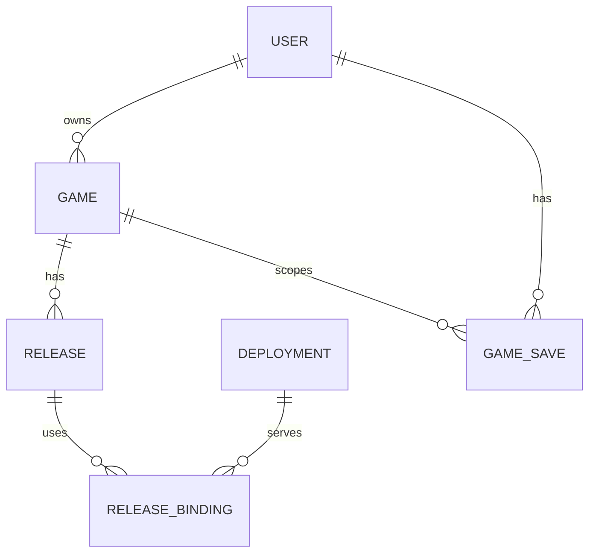

# Пользователи, роли, игры и размещения — контракт R2

Дата: 2026-10-20. **Проект для утверждения владельцем.**
Владелец отдельно разрешил реализацию 2А-02 и проверку миграции на временной БД:
[результат шага](HUB-STAGE-2A-02-REPORT.md). Рабочая БД, Git и публикация не разрешены.
Первое и повторное независимые ревью предоставил владелец. R1–R6 перепроверены по
исходникам, N1/N2 повторного ревью — по контракту и действующим решениям проекта
в [отчёте](HUB-USERS-ROLES-REVIEW-RECHECK.md). Внесены уточнения N1/N2; именно эти
последние правки независимо ещё не проверялись. Проверяющего запускает владелец
по [промпту](HUB-USERS-ROLES-REVIEW-PROMPT.md).

Порядок и решения владельца: [конкретный план 2А](HUB-STAGE-2A-PLAN.md).
Согласованные пункты отмечены отдельно; остальные остаются проектом для владельца.
Выполненный локальный объём 2А-02 описан в отчёте; остальные пункты остаются
требованиями. Готовность рабочей инфраструктуры и всей модели здесь не заявляется.

## 1. Подтверждённое исходное состояние

Ниже сохранено исходное состояние **до реализации 2А-02**, по которому составлялся
контракт. Изменения этого шага описаны отдельно в отчёте. Прод и рабочая база не проверялись.

| Факт | Источник |
|---|---|
| Better Auth: пароль/passkey, регистрация отключена; человеческих ролей и блокировки в БД нет | `apps/hub/src/lib/auth.ts`, `packages/db/src/schema.ts` |
| Любой вошедший считается owner | `apps/hub/src/lib/session.ts:26` |
| CLI смены пароля удаляет сессии и passkey; завершение всех операций не оформлено одной транзакцией | `packages/db/src/admin.ts:51` |
| Сохранения БД: `(user_id, game_id, key)`, FK только на пользователя; отдельно существует таблица `scores` | `packages/db/src/schema.ts:100` |
| Файловый реестр содержит текущую версию, без владельца/размещений | `packages/registry/src/index.ts:15` |
| iframe открывает корень origin игры; сервер выбирает текущую версию реестра при раздаче | `apps/hub/src/app/games/[id]/game-frame.tsx:63`, `apps/play-server/src/server.ts:111` |
| Игрок для SDK — `null`; save/load и рекорды локальные, без userId | `packages/hub-bridge/src/index.ts:199`, `game-frame.tsx:40` |
| Superwalk имеет собственные общие локальные ключи кошелька/скинов/рынка | `games/superwalk/src/meta/wallet.ts:24` |
| Пререлизы и `/kit` фильтруются общим признаком owner; прямые файлы не защищены этим фильтром | `apps/hub/src/lib/catalog.ts:35`, `apps/hub/src/app/kit/page.tsx:75`, D-060 |
| Play-server отдаёт GET/HEAD статических файлов; отдельного backend runtime в этом пути нет | `apps/play-server/src/server.ts:194` |
| Изоляция недоверенных backend/Builder и разделение рабочих узлов уже предусмотрены как будущее | `docs/ARCHITECTURE.md`, `docs/ROADMAP.md`, D-010/D-011 |

Открывать регистрацию до замены `currentOwner()` нельзя. Наличие таблицы сохранений
не означает, что игры уже синхронизируются с учёткой.

## 2. Граница хаба и игр

Хаб отвечает за учётки, права, каталог, владение, выдачу запуска и платформенные данные.
Игра — отдельный frontend и, при необходимости, отдельный backend. API платформы
имеет самостоятельный контракт; в 2А он может оставаться частью Next-приложения.
Разносить его в отдельный микросервис или репозиторий для этой границы не обязательно.

Подключение frontend: отдельный origin + sandboxed iframe + ограниченный SDK,
с проверкой и `event.source`, и точного `event.origin`. JS игры не импортируется в
документ хаба. Module Federation загружает удалённые модули и может подключать их
через script в страницу: вывод из этой модели исполнения — она сама не даёт
изоляции от DOM/сессии хаба. Независимый хостинг не требует такого импорта.
[webpack](https://webpack.js.org/concepts/module-federation/),
[HTML Standard](https://html.spec.whatwg.org/multipage/iframe-embed-object.html#attr-iframe-sandbox).

Игра не получает платформенную сессионную куку, email, глобальную роль или ключ
управления размещением. Псевдоним игрока стабилен в рамках gameId, а не общего
профиля для сопоставления всеми авторами. Серверное хранение клиентских данных
не подтверждает награды и валюту; авторский backend также не становится доверенным
источником общей экономики только из-за размещения у нас.

## 3. Идентичность игры, релиз и размещение

Это логическая схема, не готовая SQL-миграция.

| Сущность | Что закрепляет |
|---|---|
| User | Одна роль `user/developer/admin/owner`, состояние `active/suspended`, поколение безопасности учётки |
| Game | Стабильный gameId, владелец, исторический автор, модерационная политика и её ревизия |
| Release | Неизменяемый releaseId, уникальные gameId/version, манифест, формат данных, возможности SDK и класс гарантии содержимого |
| Deployment | Отдельное размещение frontend **или** backend, способ хостинга, состояние и неизменяемая ревизия конфигурации |
| Release binding | Снимок связи релиза с точными frontend/backend-конфигурациями, origin, артефактом/образом; не указатель «что сейчас latest» |
| Launch context | Пользователь/сессия, gameId/releaseId/binding, точный origin, формат данных, scopes, срок и поколения отзыва |
| Game save / personal best | Данные игрока в рамках gameId и пространства формата/рекордов, отдельно от владельца игры |

GameId сохраняется при обновлении, передаче игры, смене домена или хостинга.
Исторический автор не меняется; для старых игр он может быть неизвестен.
Это историческая атрибуция, сама по себе не дающая прав на игру, её пререлизы
или размещения. Права владения определяются текущим владельцем; отдельный grant
проверяется независимо по действующей политике, а не выводится из истории авторства.
Владение назначает сервер, не поле из game.json/zip. Изменение URL, backend или
секретов создаёт новую ревизию размещения и требует повторной проверки, не меняет
незаметно уже утверждённый binding. Откат релиза не отменяет бан или отзыв доступа.

### 3.1 Два независимых выбора хостинга

| Компонент | Режимы |
|---|---|
| Frontend | `platform_static` — наш контролируемый артефакт; `author_origin` — инфраструктура автора |
| Backend | `none`; `platform_runtime` — наша изолированная среда; `author_endpoint` — сервис автора |

Так описываются статика у нас, frontend+backend у нас, оба компонента у автора
и смешанные варианты. В 2А модель и права учитывают все режимы, но рабочая ветка
первой реализации ограничена нынешними статическими играми. Остальные режимы
имеют явное состояние `unsupported/pending`, без кнопки запуска или мнимого deploy.

Проверка адреса автора — отдельный будущий сервис проверки: доказательство контроля
origin, HTTPS, разрешённые порты/точные origins, повторная проверка после изменения.
Нельзя произвольно скачивать URL из процесса хаба, имеющего доступ к БД. До включения
проверок необходима защита от SSRF, DNS rebinding, переходов в локальные/служебные
сети и обхода через redirects. Сохранение URL в проекте не разрешает такой запрос.

### 3.2 Неизменяемость внешних релизов — решение Q4

У контролируемого артефакта один релиз соответствует фиксированному содержимому.
Автор внешнего origin может заменить HTML, JS и зависимости по прежнему адресу.
Номер в URL, заголовок, самообъявление SDK или разовый хеш этого не предотвращают.

Предлагаются разные классы, без смешения гарантий:

- `platform_artifact`: неизменяемый артефакт и контролируемая выдача; совместим
  с действующим инвариантом неизменяемости опубликованной версии.
- `author_controlled`: внешний автор меняет содержимое; гарантия тех же байтов
  не заявляется. Допуск этого класса и доступные ему scopes требуют решения Q4
  и явного уточнения действующих решений/инвариантов, а не скрытого исключения.

До Q4 внешнее размещение — только модель/черновик. Внешние cloud-записи не включаются.
Если требуется строгая гарантия, frontend доставляется как контролируемый артефакт;
backend при этом может оставаться у автора. Его ответы по природе не являются
неизменяемыми байтами frontend и не становятся проверенными наградами.

### 3.3 Будущая изоляция backend у нас

Отдельная среда игры, квоты CPU/RAM/процессов/диска/сети, своё пространство данных;
нет доступа к БД/секретам хаба, Docker-сокету, хосту и соседним играм. Управление
средой не выполняется через сокет Docker внутри хаба. Цель — отдельные рабочие узлы
для недоверенного исполнения (D-011). Build и runtime имеют разные полномочия.

gVisor — кандидат, не выбранная и не проверенная здесь реализация. Он уменьшает
поверхность системных вызовов, но сетевые правила и ограничения ресурсов остаются
отдельными мерами: [модель безопасности gVisor](https://gvisor.dev/docs/architecture_guide/security/).
Выбор runtime, оркестрация, сборщик, S3/CDN для файлов игр и запуск чужого backend
отложены. Резервирование БД по D-047 к этой отсрочке не относится.

## 4. Роли и управление ресурсами

Роль по умолчанию — user; регистрация/профиль не принимают роль, блокировку или
emailVerified от клиента. Сервер перечитывает действующие права; неизвестное
значение/ошибка проверки дают отказ. Чувствительные действия требуют недавнего
усиленного входа и журнала. Последний активный owner защищён транзакционно.

| Действие | Гость | user | developer | admin | owner платформы |
|---|---|---|---|---|---|
| Публичные разрешённые игры | Да | Да | Да | Да | Да |
| Свои облачные данные для допущенного релиза | Нет | Да | Да | Да | Да |
| Свой профиль/пароль/passkey | Нет | Да | Да | Да | Да |
| Управлять своей игрой и черновиками её размещений | Нет | Нет | Да | Да | Да |
| Публиковать/менять активное размещение своей игры | Нет | Нет | После готовности соответствующего режима | То же | То же |
| Менять код/URL/секреты чужой игры | Нет | Нет | Нет | Нет | После явной передачи владения |
| Списки учёток и модерационные метаданные игр | Нет | Нет | Нет | Да | Да |
| Скрывать карточку/запрещать платформенный доступ user/developer-игр | Нет | Нет | Нет | Да, с причиной | Да, с причиной |
| Блокировать user/developer | Нет | Нет | Нет | Да | Да |
| Управлять admin/owner, выдавать роли, передавать игры | Нет | Нет | Нет | Нет | Да |
| Читать/менять чужие raw-сохранения через платформенный API | Нет | Нет | Нет | Нет | Нет по умолчанию |
| Web kit `/kit` | Нет | Нет | Нет | Нет | Да — сохраняется D-060 |
| Свой пререлиз через хаб | Нет | Нет | Да, если текущий владелец игры и запуск разрешён | Да, если текущий владелец игры и запуск разрешён | Да, по действующей политике |
| Чужой пререлиз через хаб | Нет | Нет | Нет | По отдельному разрешению с причиной | Да, по действующей политике |

Владелец согласовал Q1: фиксированные роли, их основные возможности, owner-only
`/kit`, отдельный допуск admin к чужому пререлизу, запрет чтения чужих сохранений
по одной административной роли и защиту последнего owner. Детали будущих режимов
размещений остаются проектом; реализация этим согласованием не разрешена.
Инвайты отложены.
Доступ к карточке/метаданным не равен запуску или получению приватных файлов.
Для модерационного доступа admin к чужому пререлизу нужен отдельный явный grant
с причиной; право модерировать само по себе его не выдаёт.

### 4.1 Согласованный механизм разрешений

Цепочка проверки: пользователь → роль → явный набор permissions → условия ресурса.
В 2А роли фиксированы; наборы разрешений и их серверные проверки задаются централизованно
в коде. В БД хранятся роль пользователя, владение играми и отдельные допуски к ресурсам.
Конструктор произвольных ролей/наборов permissions в этот этап не входит.

Например, право редактирования игры проверяется вместе с владением и действующими
ограничениями доступа. Доступ admin к конкретному чужому пререлизу проверяется по
отдельному допуску. Проверка не сводится к сравнению «роль выше developer»; роль
сама по себе не отменяет условия ресурса. Скрытие кнопок лишь отражает решение
сервера и не является проверкой полномочий.

Это согласованная модель для последующей реализации, не готовая схема БД/API.

### 4.2 Управление и передача размещений — проект деталей

Управление размещением включает создание конфигурации, публикацию binding,
изменение адресов, ограничений и write/rotate секретов своей игры, остановку своего
runtime после появления runtime. Эти permissions не дают читать чужие секреты,
готовый пароль БД или raw-значения сохранённых секретов. В 2А сервисные credentials
и управление настоящим runtime остаются выключены, а права заранее разделены.

Передача игры не переносит прогресс игроков. Она отзывает полномочия прежнего
автора, пересматривает grants/контексты и сервисные credentials размещения.
Неизменившееся историческое авторство не сохраняет отозванный доступ. Обязательная
отрицательная проверка: после transfer A→B у A нет доступа к пререлизу через старую
и новую сессию, если отсутствуют независимые действующие права на этот ресурс.
Для внешнего адреса нужна новая проверка контроля новым владельцем; до неё запуск
не разрешён. Нельзя считать замену ownerUserId отзывом доступа бывшего автора к
его внешнему серверу. Уже выданные ему данные физически отозвать невозможно.

## 5. Источники истины, модерация и доступ

**БД** определяет владельцев, роли, разрешённые релизы/bindings и модерационные
запреты. **Файловый реестр** описывает физический артефакт, но не выдаёт права.
При расхождении релиза/hash/binding запуск запрещён. Ошибка БД не переключает
проверку прав на старый файловый флаг. Сборка/повторная публикация не снимает
модерационный запрет; снятие запрета — отдельное журналируемое полномочное действие.

| Операция | Каталог | Новый запуск | Уже открытый запуск / API | Runtime |
|---|---|---|---|---|
| `hide_listing` | Скрыт | Сам по себе не запрещён по прямой ссылке | Не отзывается | Не меняется |
| `deny_new_launches` | Не предлагается запуск | Отказ | Действующий контекст сохраняется до отдельного отзыва/истечения | Не меняется |
| `suspend_platform_access` | Скрыт, запуск не предлагается | Отказ | Контексты отозваны; save/load/score отказывают | Сам по себе не останавливает процесс |
| `stop_platform_runtime` | Показывает недоступность сервера | Backend-запуск не готов | Серверный запрос завершается ошибкой | Останавливает только наш runtime |

Владелец согласовал базовую политику Q7 для первого этапа: обычное административное
«заблокировать игру» означает `suspend_platform_access`; простое скрытие называется
именно скрытием и сохраняет запуск по прямой ссылке. Это согласование требований,
не разрешение на реализацию. Дополнительные режимы deny_new_launches и управления
будущим runtime остаются деталями проекта.
Запрет проверяется на запуске и **каждой** платформенной операции, включая load
и bestScore. Старый контекст, предыдущий binding или откат версии его не обходят.
Передача игры не снимает запрет. Блокировка автора отзывает его доступ, но не
удаляет игры/чужой прогресс и не снимает модерационные ограничения; судьба
публичных запусков его игр определяется отдельным действием модерации.
Причина фиксируется и при применении ограничения, и при его отмене.
Список platform owner и владельцев существующих игр ещё требует отдельного
подтверждения до backfill; согласование модерации не утверждает этот список.

Файлы нынешних публичных статических игр могут оставаться доступны напрямую —
это предел контроля **платформенного доступа**, а не обещание физического снятия
файлов. Приватные файлы, обложки, архивы требуют отдельного контроля на выдаче.
Нашей командой нельзя остановить внешний сервер или забрать уже скачанные файлы.
Недоступность backend не превращается в успешное сохранение/локальную подмену.

## 6. Вход, восстановление и отзыв средств доступа — Q2/Q3

Владелец согласовал политику входа и восстановления Q2. Это согласование требований,
не разрешение на реализацию; почтовый relay и его сетевой маршрут ещё нужно выбрать.

Email/пароль и необязательный passkey игрокам и разработчикам; подтверждение email
до облака и публикации игр. Роли, CSP, доставка писем и политика лимитов готовы до
публичной регистрации. Для admin/owner обязательны UV-passkey либо пароль + TOTP,
а для чувствительных действий — недавнее усиленное подтверждение. При passkey
сервер проверяет user verification, а не только факт присутствия пользователя.

Согласованная политика восстановления:

| Сценарий | Доказательство и последствия |
|---|---|
| Обычная смена пароля | Проверенная текущая учётка, старый credential и недавнее подтверждение, включая настроенную усиленную защиту; все сессии/контексты и ссылки восстановления отзываются. Ранее привязанные passkey/TOTP сохраняются после этой проверки. Этот обычный маршрут отделён от recovery и аварийного CLI |
| Почтовый сброс/подозрение на утечку пароля | Новый пароль, отзыв всех сессий/контекстов и всех passkey, старых reset/enrolment токенов. Существующий второй фактор не обходится почтовой ссылкой; без его доказательства обычный вход с обязательным MFA не завершается |
| Восстановление/компрометация усиленного входа | Отдельное доказательство: заранее выданные одноразовые резервные коды либо проверенная операторская процедура для аварийного восстановления owner. Отозвать прежние passkey/TOTP/recovery codes, сессии и grants; заменить набор факторов. Email или новый пароль сами не разрешают перевыпустить фактор admin/owner |
| Аварийный CLI владельца | Уполномоченный оператор, полный отзыв сессий/контекстов, затронутых credentials и recovery-токенов. Одноразовый короткий маршрут повторной настройки фактора с ограниченными полномочиями; не обычная owner-сессия и не публичный обход MFA |

Повторная настройка owner должна быть достижима после полного отзыва: резервное
доказательство/оператор выдаёт только право настроить новый фактор. Оно не разрешает
роли, игры, данные или выпуск новых игровых grants. После настройки требуется
новый усиленный вход; флаг «административный вход подтверждён» восстановление не выдаёт.
Список затрагиваемых credentials и значение security generation изменяются согласованно
с паролем/факторами в транзакционной процедуре; частичный отзыв не считается успехом.
Нынешний CLI пока не имеет всего этого — это требование будущей реализации R1.
Если почтовый сброс удалил единственный passkey усиленного входа, один новый пароль
не открывает административный доступ: нужен описанный маршрут восстановления фактора.
Нынешний CLI с полным отзывом passkey не подменяется обычной сменой пароля из профиля.

Все изменяющие запросы сохраняют Origin + CSRF и `__Host-`; общий кеш сессий/прав/данных
запрещён. Выход, блокировка и recovery отзывают launch contexts; scopes и поколения
учётки/игры/размещения проверяются на следующей операции платформы. Смена A на B
не переносит память моста, pending-запросы или старый контекст в новую учётку.

Письма: одноразовые короткие токены, фиксированные адреса возврата, одинаковые внешние
ответы, без токенов в логах. Нормализация email одинакова; коллизии старых записей
проверяются до миграции. Хаб изолирован от интернета (D-038): нужен отдельно
утверждённый relay/сетевой маршрут, не открытие всего интернета хабу.
Для текущего этапа владелец выбрал Resend Free (D-063); подключение и сетевой маршрут
ещё согласуются. Полноценная собственная почта на VPS отложена отдельной задачей
[ROADMAP](ROADMAP.md) и не является условием готовности текущего этапа.

Владелец согласовал направление Q3: одинаковая для всех ролей многоуровневая политика
вместо различия «owner/неизвестный email строго, игрок мягко». Независимые счётчики:

- Введённый нормализованный email: ограничивает перебор одной учётки с разных IP;
  одинаковые правила и для несуществующего адреса, без раскрытия его наличия.
- Случайный ID браузера в защищённой cookie: ограничивает источник попыток,
  но не считается доказательством личности или разрешением обойти MFA.
- IP: общий предел массовых попыток, который не сбрасывается сменой UA/cookie.
- User-Agent и IP + UA: дополнительные сигналы, а не самостоятельная идентичность.

UA можно подменить, cookie удалить; хэш UA не устраняет эти ограничения. Нельзя
заменить общий IP-счётчик только ключом IP + UA или ID браузера. Блокировать всех
пользователей с одинаковым UA тоже нельзя. Память счётчиков и число новых ключей
ограничиваются, чтобы случайные email/UA/cookie не приводили к неограниченному росту.

Сначала задержки и временные ограничения конкретного источника; общий IP-бан при
массовом переборе. Пороги, сроки, сброс/эскалация и граница fail2ban ещё не согласованы;
новая схема не означает принятие прежних 5 отказов как порога общего IP-бана.
Текущая защита не снимается до отдельно согласованной и проверенной замены.
Нужно проверить `429/Retry-After`, задержки, контрольный вход в свою учётку и
фактический бан на всех рубежах. Одинаковый текст не объявляется неразличимостью;
по чужим неудачам нельзя получить бессрочную блокировку учётки жертвы.

Основание ограничения UA: [OWASP о device fingerprinting](https://cheatsheetseries.owasp.org/cheatsheets/Credential_Stuffing_Prevention_Cheat_Sheet.html#device-fingerprinting).
Реализация и проверка Q3 остаются условием открытия публичной регистрации.

## 7. Обязательный контракт запуска до первой облачной записи

Контекст закрепляет user/session, game/release/binding/deployment revision,
точный frontend origin, пространство данных и рекордов, scopes, срок, поколения
отзыва и тип гарантии артефакта. UserId определяется серверной сессией, не полем
запроса. Браузер не выбирает чужую игру/учётку/формат простым параметром API.

**Реально выданные файлы должны соответствовать релизу контекста.** Нужен
контролируемый путь выдачи фиксированного артефакта для HTML **и всех assets**,
без обращения к mutable latest при каждом запросе. Сам query `?version=...`, header
или hello игры доказательством не являются. Предлагаемый строгий вариант Q5 — origin,
закреплённый за конкретным релизом; его маршруты не отдают другой релиз. Навигация
iframe на другой origin не получает прежний доступ к мосту. Альтернатива на общем
origin требует отдельного доказанного протокола привязки документа/навигации.
До выбора и проверки такого решения текущий `${gameOrigin}/` не допускается к облаку.

Это минимальная доработка существующей статической выдачи, обязательная в 2А для
первого cloud-релиза; не обещание готового хостинга произвольных авторских пакетов.
При гонке v1→v2 старая вкладка либо продолжает со своим неизменяемым v1/форматом,
либо явно отзывается. Код v2 не записывает в формат F1 по старому контексту.
Неизвестное/неподдерживаемое сочетание версии, SDK и формата даёт отказ.

Для будущего backend — отдельное ограниченное разрешение с audience игры/сервиса,
псевдонимом игрока, scopes, сроком, защитой от повторного обмена и отзывом. Management
credential автора не является игровым разрешением. Способ обмена/подписи/introspection
проектируется перед backend-интеграцией; один offline JWT не обещает мгновенный отзыв.
Игра не получает полномочий к другим играм. Внешний backend может игнорировать наш
отзыв у себя, но после отзыва платформенные операции ему не разрешены.
В 2А выдача таких backend-разрешений выключена; активен только parent→platform API.

## 8. Прогресс, SDK, локальный кеш и рекорды

### 8.1 Один источник истины для каждого вида данных

| Режим | Источник | Обещание пользователю |
|---|---|---|
| `legacy_local` | Устройство/origin игры | Общий гостевой прогресс устройства; нет гарантии разделения учёток/переноса |
| `platform_sdk` | Платформенное API и БД | Изолированный прогресс учётки для проверенного релиза; локальный кеш не источник истины |
| `game_backend` | Хранилище конкретной игры | Будущий режим: синхронизация/перенос по её контракту; не дублируется скрытой записью в БД хаба |

Источник выбирается для каждого пространства/вида данных релиза. Нельзя дать
backend и хабу одновременно независимо менять одну «истинную» запись. Настройки,
прогресс и персональные рекорды могут иметь разные явно объявленные источники.
Данные авторской БД находятся под контролем автора; запрет raw-save API хаба не
означает, что автор не видит собственную БД. Платформенная БД/секреты туда не передаются.
Перенос хостинга не меняет платформенный gameId; перенос БД backend — отдельная процедура.

### 8.2 Допуск к прогрессу учётки

До активации cloud-релиза обязательны pinned delivery, совместимость SDK/формата,
явная обработка конфликтов и доказанная изоляция **всего** его пользовательского
состояния при A→B→гость, включая memory/cache/localStorage/IndexedDB игры.
Простого reload iframe или экспортного адаптера недостаточно (R3).

Для адаптированных игр кеш разделён по псевдониму/пространству; после выхода данные
A не читаются в B. Хаб не может волшебно очистить чужой origin. Старые общие ключи
не удаляются автоматически и не импортируются в текущую учётку. Superwalk до новой
адаптированной версии остаётся `legacy_local` для кошелька/скинов/рынка.

Поддержка SDK v1: методы save/load сохраняют форму, parent держит ревизию после load;
save использует CAS относительно прочитанной ревизии. Для существующего ключа без
предыдущего load — явный `load-required`, для гонки — `conflict`; скрытых retry с
перезаписью и успеха после локального fallback нет. Создание ключа — CAS с нулевой
ревизией. Потерянный ответ требует повторного load, не слепой повтор старого payload.
Релиз, не умеющий обработать эти условия, не получает cloud-write до адаптации.
Конкретные типы ответов/ошибок и проверки существующего SDK обязательны до активации,
не отложены на последующий импорт (R2).

У v1 нет явной baseRevision в запросе игры: кеш ревизии в parent сам по себе
не доказывает, на каком чтении основана запись. Для допуска нужна проверенная
последовательность load→изменение→save одного потребителя ключа, с упорядочиванием
запросов. Если адаптер не может обеспечить её, cloud-write v1 остаётся выключен;
нужен версионированный протокол с явной ревизией. Общая совместимость всех старых
игр с облаком не обещается.

Save scope: user/game/save-space/key; 64 КиБ на значение, предварительно 32 ключа
и 1 МиБ суммарно по save-spaces на пользователя/игру — Q6. Квота/ревизия/запись
атомарны. Совместимые патчи используют один save-space; несовместимые форматы — новый,
старые данные сохраняются. Правила совместимости действуют с первой cloud-записи.

### 8.3 submitScore и bestScore входят в тот же обязательный шаг

Область — текущий пользователь/gameId/score-space, выбранный политикой релиза,
не клиентским параметром сезона. Предлагается ограниченная проекция персонального
рекорда: атомарный максимум, одна запись на область; бесконечного append всех
клиентских отправок в нынешний `scores` нет. Исторические строки не удаляются и
не становятся автоматически подтверждёнными результатами. Сезоны/новые score-spaces
включаются контролируемо, с лимитом их числа и политикой хранения до активации.

SDK сохраняет `submitScore → {best,isBest}` и `bestScore → number|null`.
Оба метода проверяют ту же сессию, запуск, модерацию и источник данных, что save/load;
рекорд не остаётся общей локальной переменной устройства для cloud-игрока.
Проверяются finite-число, диапазон политики игры и серверная частота запросов на
пользователя/сессию с общим ограничителем, чтобы новые сессии не снимали лимит.
Рекорд помечен как недоверенная клиентская заявка; нет общего проверенного
лидерборда, начисления валюты или наград. Q6 определяет продуктовую семантику рекордов.

### 8.4 Импорт старых данных — поздний отдельный шаг

Гость продолжает локально. Вход не присваивает старые ключи текущей учётке.
Ручной импорт требует выбора игры, подтверждения и показа конфликта с облаком;
кошельки/инвентарь не сливаются автоматически. Ключи без userId не доказывают
прежнего владельца; данные origin игры требуют её собственного адаптера экспорта.
Импорт не повышает доверие к наградам. Копия исходных данных сохраняется до успеха.
Нет API/сети — видимая ошибка cloud-операции, не успех с тихим локальным сохранением.

## 9. Переход и условия допуска

Миграции только расширяющие, сначала копия со старыми данными: явный owner/user,
список игр и владельцев, коллизии email, orphan gameId в saves/scores и квоты.
Неизвестные старые записи не удаляются и не присваиваются молча: отчёт, карантин
или решение по переносу до включения нового FK. Удаление автора не каскадирует
на игры/чужой прогресс; физическое удаление получает отдельную процедуру.

После регистрации игроков нельзя откатиться к коду «вошёл = owner». Выключить
регистрацию недостаточно: учётки уже существуют. Допустим только RBAC-совместимый
откат либо отдельно проверенный аварийный план. Удаление/понижение последнего owner
защищено транзакционно; чувствительные действия журналируются без секретов/прогресса.

Публичный доступ игроков требует готовых RBAC, восстановления, CSP, почты и Q3.
До открытия публичной регистрации/допуска игроков и до первой облачной записи
обязательны резервирование БД и проверенное восстановление по D-047:

- Горячий бакет/реплика с RPO в минутах согласно действующему решению. Нынешний
  суточный дамп сам по себе не выполняет это условие. Проверяется возраст данных,
  реально доступных для восстановления, а не только время копирования в бакет.
- Восстановление копии из штатной цепочки резервирования с данными актуальной
  схемы в отдельную изолированную БД,
  с проверкой связей учёток/ролей и имеющихся игровых данных. Проверка пустой схемы
  не заменяет проверку с данными; повторить её после появления saves/scores.
- Проверяемое свидетельство оператора: дата, измеренный RPO, время восстановления
  и результат проверки данных. Пока свидетельства нет, условие не выполнено.

Резервирование БД отделено от будущего S3/CDN для файлов игр; менять D-047 можно
только отдельным решением владельца. Реальные копии здесь не проверялись и доступ
к рабочим данным/инфраструктуре этой документальной правкой не разрешается.
Это условие эксплуатационного включения, не запрет готовить роли на тестовой БД.

Первое облако дополнительно требует раздела 7, допуска игры по 8.2/8.3 и проверки
восстановления копии с тестовыми saves/scores актуальной схемы до приёма данных игроков.
Открытие чужого кода, даже если названо ранним этапом, требует отдельного домена
для управляемого контента, раздельных origins, проверенной раздачи и запрета доступа
к доверенной инфраструктуре. Предлагается привязать срок D-010/D-011 к этому факту,
а не автоматически считать защиту готовой по номеру этапа. Это решение Q5 владельца.
Текущий компромисс доверенных игр не распространяется молча на пользовательские игры.

## 10. Граница 2А и последующего хостинга

В 2А обязательны работающие роли/учётки, владение, журнал, политика модерации,
сущности релизов/размещений и вертикальный срез собственного прогресса выбранной
поддерживаемой статической игры. До него уже готовы pinned delivery, базовая
совместимость версий/SDK и изоляция кеша. Импорт старого прогресса может быть позже.

Модель author-hosted и backend-hosted описана сейчас, но сами runtime, zip-upload,
Builder, внешние probes/активация, S3/CDN для файлов игр и серверные делегированные credentials
получают следующие отдельные планы. Серверная экономика и доказательства забегов
также не входят в 2А. Расширять реализацию можно только после решения владельца.

Утверждение контракта и каждого следующего шага — за владельцем. Рабочие вопросы
Q1–Q7 и порядок зависимостей находятся в [плане](HUB-STAGE-2A-PLAN.md).
